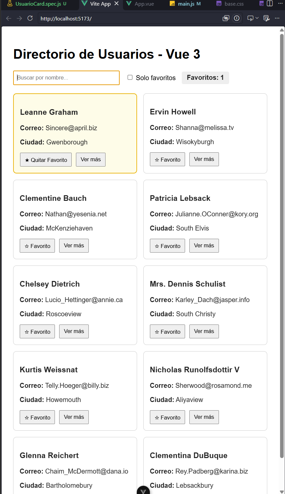
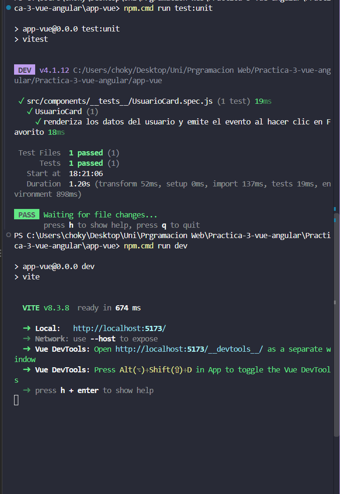
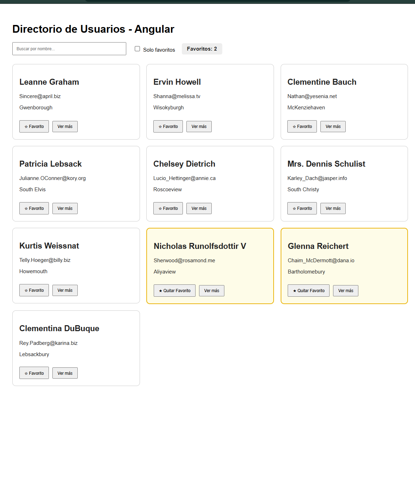
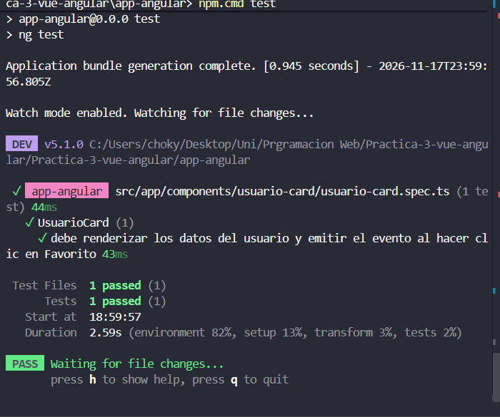

# Práctica - Desarrollo Interactivo de App (Parte 3)

**Estudiante:** Michael Yumbla  
**Carrera:** Computación — Universidad Politécnica Salesiana (Sede Cuenca)  
**Frameworks implementados:** Vue 3 y Angular  
**API pública consumida:** `https://jsonplaceholder.typicode.com/users`

---

## 📁 Estructura del Repositorio

```text
Practica-3-vue-angular/
├── app-vue/        # Implementación en Vue 3 (Composition API + Vitest)
├── app-angular/    # Implementación en Angular (Standalone Components + Testing)
├── capturas/       # Evidencias gráficas de interfaz y pruebas unitarias
└── README.md       # Documentación, comandos de ejecución y evidencias
```

---

## ✨ Funcionalidades Implementadas (en ambos frameworks)

- **Consumo de API REST:** Consulta asíncrona mediante `fetch` con manejo de estados de carga (`Cargando...`) y control de errores de red o respuesta HTTP.
- **Componente reutilizable de tarjeta (`UsuarioCard`):** Recibe los datos de cada usuario mediante propiedades (`props` en Vue / `@Input()` en Angular) y emite un evento hacia el componente padre (`emit` en Vue / `@Output()` en Angular) al marcar o desmarcar favoritos.
- **Filtrado reactivo en tiempo real:** Búsqueda dinámica por nombre mientras el usuario escribe.
- **Gestión de favoritos:** Botón interactivo en cada tarjeta con cambio visual de estado y contador dinámico `Favoritos: N`.
- **Funcionalidades adicionales:**
  - Filtro combinado mediante casilla **"Solo favoritos"**.
  - Botón **"Ver más / Ver menos"** en cada tarjeta para desplegar teléfono y empresa del usuario.
- **Pruebas unitarias:** Verificación automatizada del renderizado de datos del usuario y de la emisión del evento de favoritos.

---

## 🚀 1. Ejecución de la aplicación en Vue 3 (`app-vue`)

1. Ingresar a la carpeta del proyecto Vue:
   ```bash
   cd app-vue
   ```
2. Instalar dependencias:
   ```bash
   npm install
   ```
3. Iniciar el servidor de desarrollo local (se abrirá en `http://localhost:5173`):
   ```bash
   npm run dev
   ```
4. Ejecutar la prueba unitaria con Vitest:
   ```bash
   npm run test:unit
   ```

### 📸 Evidencias de funcionamiento — Vue 3

**Aplicación en ejecución (tarjetas, buscador en vivo y contador de favoritos):**  


**Prueba unitaria aprobada (`UsuarioCard.spec.js`):**  


---

## ⚡ 2. Ejecución de la aplicación en Angular (`app-angular`)

1. Ingresar a la carpeta del proyecto Angular:
   ```bash
   cd app-angular
   ```
2. Instalar dependencias:
   ```bash
   npm install
   ```
3. Iniciar el servidor de desarrollo local (se abrirá en `http://localhost:4200`):
   ```bash
   npm start
   ```
4. Ejecutar la prueba unitaria:
   ```bash
   npm test
   ```

### 📸 Evidencias de funcionamiento — Angular

**Aplicación en ejecución (tarjetas, buscador en vivo y contador de favoritos):**  


**Prueba unitaria aprobada (`usuario-card.spec.ts`):**  
